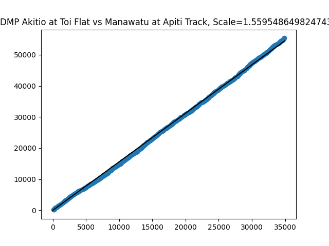
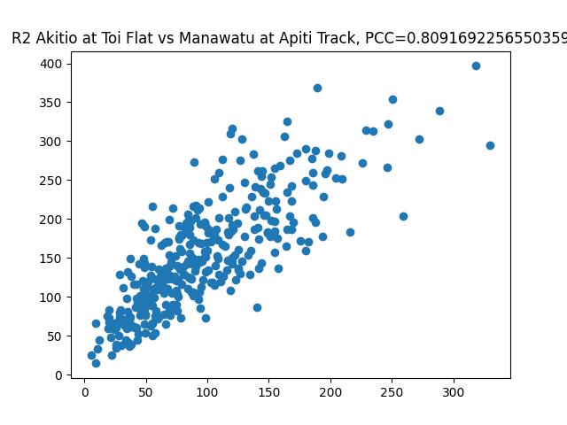
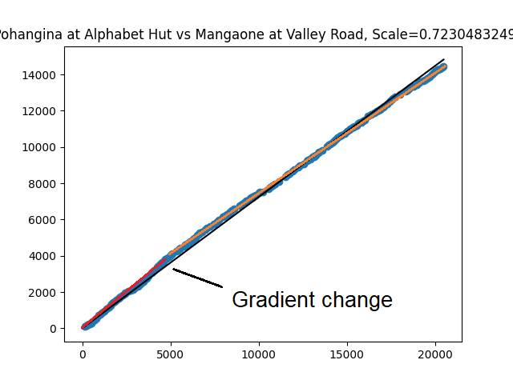

# Double mass plots

Utility for rainfall site comparisons.

The intended use is for helping select alternative sites for synthetic rainfall data.

## What are double mass plots?

Double mass plots are plots that compare the cumulative rainfall totals of two sites.
This is useful to compare the linearity of the relationship between sites.
It also generates a scale factor, which is used to adjust data between sites.
For example, if the scale factor between Site A and Site B is 0.9, then to use site B data as synthetic data for
site A, the site B data should be multiplied by 0.9 first.

This tool also generates scatter plots which just compare the monthly totals for the two sites.
This is useful for finding how well correlated the rainfall is between sites.
This also generates the correlation coefficient (aka R or PCC), which represents how well correlated they are.
The R values go from -1 to 1, with higher values indicating better correlation.

### What's the difference between correlation and linearity?

Correlation shows how likely it is for rainfall at one site to represent rainfall at the other.
Site pairs with low correlations have frequent rainfall patterns which show up in the data of one site but not the
other, or the amount that shows up in each site does not have a fixed relationship.

Linearity shows how that relationship changes over time. Ideally for two sites to be comparable, the relationship
should be highly linear. If there are significant deviations from a linear double mass plot, it indicates that there
may be some change in the stationarity of the data for one or both sites.

If there has been a significant change at one of the sites, this may show up as a "dog-legged" double mass plot.
When something like this occurs, you should consider rerunning the analysis for only the more relevant period
(generally just looking at the data after the change causing the dog-leg shape). This will result in a more
representative scaling factor. You could also consider using an alternative site.

Below is an example of a slight dog leg - values up to approximately 5000 on the x axis show a higher gradient than
values above 5000 on the "x" axis

The best available site from a given selection is generally the one with the higher R value.
However, human judgement should be used to ensure this is the best selection.
Some examples of things that might be considered are:

- Linearity of the relationship
- Length of record
- Locations of sites

## What this tool does

### Find sites

This tool finds sites that have "R_Rain" values in the hilltop site table metadata.
These sites are a manually curated list of sites that are reasonably close while also accounting for geography.

If a custom site comparison is required, set the custom tag to true and put in the site and supplementary sites you
require. This will only calculate the comparisons for those sites, and will avoid looking for the R_Rain value.

### Plot and calculate stats for site and it's comparable sites

Plots both the double mass plot and the correlation plots, as well as the scale factor and R value.

### Save plots and coefficients

Saves plots in a subfolder of "./output/", as well as the correlation and scale factors